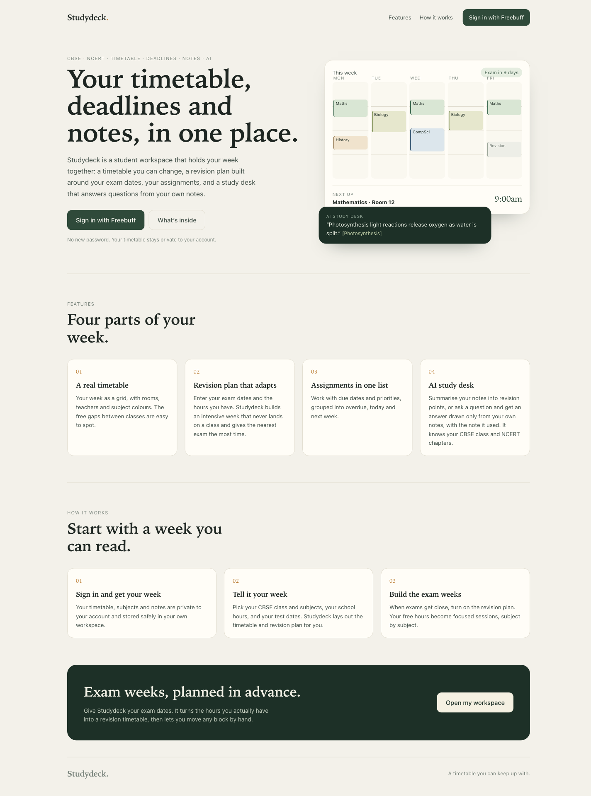

# Studydeck

[](https://github.com/pixels-ux/studydeck/actions/workflows/ci.yml)

A timetable, work and syllabus organiser for CBSE/NCERT students. Tell it your
class, your subjects and your test dates; it lays out your week and an exam
revision plan, then keeps assignments, chapters and notes in one workspace that
only you can see.




## What it does

- **Class setup** — your class, subjects and colours, school hours and period
  length, test dates, and how many hours you can study. A weekly timetable and
  an intensive revision plan are generated from that.
- **Today** — the classes you have, the work that is due and the exams coming up.
- **Timetable** — your week as a grid with rooms, teachers and subject colours,
  plus the revision plan. Study sessions never land on a school class, and the
  nearest exam gets the most time.
- **Work** — assignments with due dates and priorities, grouped into overdue,
  today and next week.
- **Syllabus** — NCERT chapters ticked off per subject.
- **Notes** — private notes per subject.
- **Your data** — download subjects, timetable, tasks, notes and syllabus as one
  JSON file, or delete the whole workspace from the server.
- **Calendar** — export the week and the revision plan as an `.ics` file for
  Google Calendar, Apple Calendar or Outlook.
- **AI study desk** — summarise your notes into revision points, or ask a
  question answered only from your own notes, with the note it used. It knows
  your class and chapters. Capped at 40 actions per student per day.

## Stack

- React 19 and Vite for the interface (`src/client`).
- A Hono app for the API (`src/worker/app.ts`), run as a Cloudflare Worker in
  production and through a small Node HTTP server on a plain host
  (`src/node/server.ts`).
- SQL through one small surface, `prepare` / `bind` / `first` / `all` / `run` /
  `batch` (`src/worker/sql.ts`). Cloudflare D1 satisfies it directly; on Node,
  `src/node/sqlite.ts` implements it over `node:sqlite`.
- Sign in with Freebuff for accounts, with every row scoped to the signed-in
  user's `sub` (`src/worker/auth.ts`, `src/worker/db.ts`).

## Run it locally

```sh
bun install          # or npm install
bun run dev          # Vite dev server, Worker with a local D1 database
```

Open the URL Vite prints. On a loopback origin with no auth configuration the
app uses a single, clearly labelled local preview identity, so you can use it
without signing in. That fallback never applies to a hosted origin.

```sh
bun test             # API, plan and SQLite adapter tests
bun run typecheck    # client, worker, node and test projects
bun run build        # Sites/Worker build into dist/
```

## Configuration

Everything is optional locally; see `.env.example`.

| Variable | Purpose |
| --- | --- |
| `AI_PROVIDER` | Which service answers: `freebuff`, `openrouter`, `gemini`, `openai` or `ollama`. When omitted it is detected from the keys you set. |
| `OPENROUTER_API_KEY` | OpenRouter key. Model defaults to `openrouter/auto`. |
| `GEMINI_API_KEY`, `GOOGLE_API_KEY` | Google Gemini key. Model defaults to `gemini-2.5-flash`. |
| `GROQ_API_KEY` | Groq key. Model defaults to `llama-3.3-70b-versatile`. |
| `MISTRAL_API_KEY` | Mistral key. Model defaults to `mistral-small-latest`. |
| `DEEPSEEK_API_KEY` | DeepSeek key. Model defaults to `deepseek-chat`. |
| `TOGETHER_API_KEY` | Together key. Model defaults to `meta-llama/Llama-3.3-70B-Instruct-Turbo`. |
| `AI_API_KEY` | Key for a service you point at with `AI_PROVIDER=custom`. |
| `OPENAI_API_KEY` | A Freebuff key by default; an OpenAI key when `AI_PROVIDER=openai`. Without any key the desk shows a setup card and the rest of the app works. |
| `OLLAMA_BASE_URL`, `OLLAMA_MODEL` | Point the desk at a local Ollama. No key needed. |
| `AI_BASE_URL` | Any other OpenAI-compatible endpoint; beats the built-in URL for the chosen provider. |
| `OPENAI_BASE_URL` | Older name for the same override, kept for existing deployments. |
| `AI_MODEL` | Model name. On Freebuff it must be one of the allowlisted models; elsewhere any name the service accepts. |
| `FREEBUFF_CLIENT_ID`, `FREEBUFF_ISSUER`, `APP_ORIGIN` | Enable Sign in with Freebuff. `APP_ORIGIN` is the public origin including scheme. |
| `DATABASE_PATH` | Node host only: SQLite file, default `data/studydeck.db`. |
| `PORT`, `HOST` | Node host only: default `3000` and `0.0.0.0`. |

The Node entry reads plain `process.env`, so load a `.env` with
`node --env-file=.env dist/node/server.js`, or use your host's environment
settings. Bun loads `.env` on its own.

`.env` is gitignored. Never commit keys: this repository needs no secrets to
build or test, and the one runtime key belongs in the host's environment.

### AI providers

The study desk talks to any service that speaks the OpenAI chat-completions
API, so one request shape covers all of them:

```sh
AI_PROVIDER=openrouter OPENROUTER_API_KEY=...  # https://openrouter.ai/keys
AI_PROVIDER=gemini     GEMINI_API_KEY=...      # https://aistudio.google.com/apikey
AI_PROVIDER=groq       GROQ_API_KEY=...        # https://console.groq.com/keys
AI_PROVIDER=mistral    MISTRAL_API_KEY=...     # https://console.mistral.ai/api-keys
AI_PROVIDER=deepseek   DEEPSEEK_API_KEY=...    # https://platform.deepseek.com/api_keys
AI_PROVIDER=together   TOGETHER_API_KEY=...    # https://api.together.ai/settings/api-keys
AI_PROVIDER=openai     OPENAI_API_KEY=...      # https://platform.openai.com/api-keys
AI_PROVIDER=freebuff   OPENAI_API_KEY=...      # default, spends Freebuff credits
```

Anything else that speaks the OpenAI chat-completions API works through
`custom`:

```sh
AI_PROVIDER=custom AI_BASE_URL=https://your-service/v1 AI_MODEL=your-model AI_API_KEY=...
```

With no `AI_PROVIDER`, the first key that is set wins in the order OpenRouter,
Groq, Gemini, DeepSeek, Mistral, Together, Freebuff. `AI_MODEL` picks a model;
each provider has a default, and Freebuff keeps a server-side allowlist so the
browser can never choose one.

Ollama runs on the machine serving the app and needs no key or account:

```sh
ollama pull llama3.2
ollama serve
AI_PROVIDER=ollama OLLAMA_MODEL=llama3.2 bun start
```

Ollama is only used when you point at it (`AI_PROVIDER=ollama`, or
`OLLAMA_BASE_URL`/`OLLAMA_MODEL`), so a deployment without keys stays off
instead of failing against `localhost`. A Cloudflare Worker cannot reach your
machine, so on Sites use a hosted provider, or a public tunnel URL in
`AI_BASE_URL`. The Node server prints which provider it found at startup.

Keys never reach the browser, and every student is capped at 40 AI actions a
day. Provider errors the student can act on (a refused key, a missing Ollama
model, a rate limit) are shown as they are; everything else stays generic.

### Sign in with Freebuff

Accounts are OIDC + PKCE and need no client secret. Each origin needs one
public client ID, registered once by the project owner:

```sh
npx @freebuff/auth register --project <project-slug> --name "Studydeck" \
  --environment production --redirect-uri https://<origin>/auth/freebuff/callback
```

Set the printed `FREEBUFF_CLIENT_ID` plus `APP_ORIGIN=https://<origin>`. The
callback path is always `/auth/freebuff/callback`. On Freebuff Sites the
platform injects these three variables at deploy time and no manual
registration is needed.

## Deploy

### Freebuff Sites / Cloudflare Workers

`deploy.json` and `wrangler.jsonc` build and publish the Worker with static
assets from `dist/client`, and D1 as the `DB` binding. `bun run build` produces
the bundle. Enable Sign in with Freebuff for the site so the platform supplies
`FREEBUFF_CLIENT_ID`, `FREEBUFF_ISSUER` and `APP_ORIGIN`.

### A plain Node host

```sh
bun run build:node   # dist/client + dist/node/server.js
DATABASE_PATH=/var/lib/studydeck/studydeck.db PORT=3000 bun start
```

This works on a VPS, Render, Railway, Fly or in a Docker image with a volume.
The SQLite file must live on **persistent** storage: a host whose filesystem is
wiped between deploys or invocations (Vercel and other serverless function
platforms) will lose student data, so use the Worker/D1 path there instead.

## Project layout

```
src/client/    React pages, styles and the plan generator
src/shared/    Types and the NCERT curriculum shared by browser and server
src/worker/    Hono app, D1/SQLite query surface, schema, AI desk, auth
src/node/      Node HTTP entry and the node:sqlite adapter
tests/         API, planning and adapter tests
scripts/       Post-build step for the Worker build
```

## Tests

`bun test` runs the API against a real local D1 database through Miniflare:
CRUD, two-student isolation, signed-out refusals, foreign-origin rejection and
input validation, plus the revision-plan rules and the SQLite adapter's schema,
batch commit and rollback. Test identities are injected into the app factory
only; the shipped Worker always uses the real auth SDK.

A hosted deployment still needs a manual check of the real sign-in, callback and
sign-out flow with two accounts, since a passing unit test and a successful
redirect do not prove it.

Both commands run in CI on every push to `main` and on every pull request
(`.github/workflows/ci.yml`).

## License

[MIT](LICENSE).
