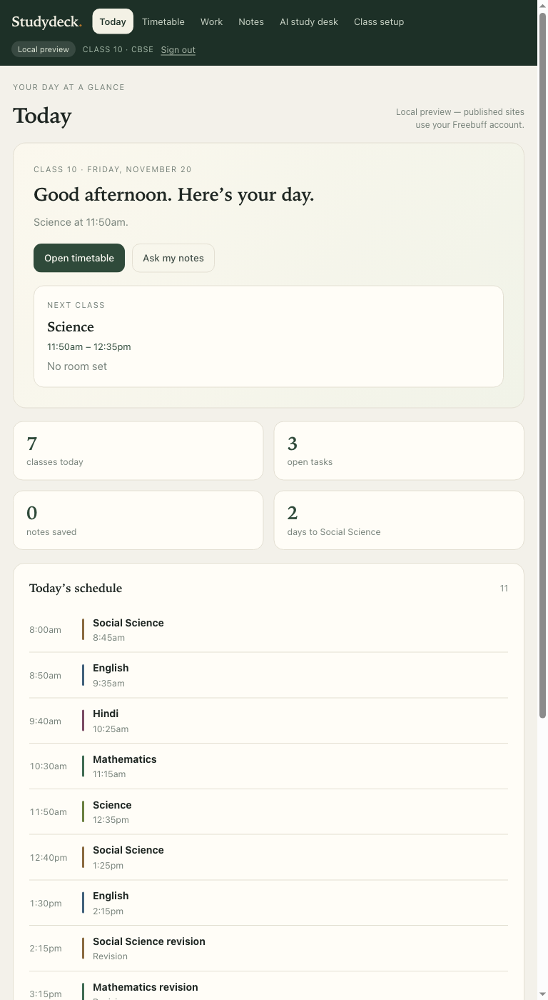

# Studydeck

[](https://github.com/pixels-ux/studydeck/actions/workflows/ci.yml)

A timetable, work and syllabus organiser for CBSE/NCERT students. Tell it your
class, your subjects and your test dates; it lays out your week and an exam
revision plan, then keeps assignments, chapters and notes in one workspace.

It runs on your own computer. Clone it, run two commands, and everything —
timetable, notes, tasks, your AI key — lives in a single file in the project
folder. No account, no server to sign up for, nothing sent anywhere except the
AI requests you ask for yourself.



## Run it

You need [Bun](https://bun.sh) (or Node 22.5+ and npm).

```sh
git clone https://github.com/pixels-ux/studydeck.git
cd studydeck
bun install
bun run dev
```

Open <http://localhost:3000>. The first run asks for your class and subjects,
then builds your week. `bun run dev` reloads the page as you edit the code.

For a single build you can start at any time:

```sh
bun run build     # client into dist/client, server into dist/server
bun start         # http://localhost:3000
```

## What it does

- **Class setup** — your class, subjects and colours, your school timetable
  (type it period by period), optional coaching days, test dates, and how many
  hours you can study. A weekly timetable and an intensive revision plan are
  built from that.
- **Today** — a check-in for the day just taught, tonight's plan, the classes
  you have, the work that is due and the exams coming up.
- **Your day** — say what was actually covered in school and at coaching, what
  homework was set and how much, then get an evening plan with breaks sized to
  the backlog. An AI brief comments on it if a key is connected.
- **Timetable** — your week as a grid with rooms, teachers and subject colours,
  plus the revision plan. Study sessions never land on a school class, and the
  nearest exam gets the most time.
- **Work** — assignments with due dates and priorities, grouped into overdue,
  today and next week.
- **Syllabus** — NCERT chapters ticked off per subject.
- **Notes** — private notes per subject.
- **Search** — one box, opened with ⌘K or Ctrl+K, over this notebook's notes,
  material, work and chapters, plus the names of your other notebooks. Picking a
  result opens the note, filters the Library to that material, scrolls to the
  task or chapter, or switches book.
- **Library** — your own material: paste a chapter or add a text file, search
  inside it, ask questions answered only from it with citations, and turn one
  item or a whole subject into revision notes, practice questions, flashcards or
  a slide deck.
- **Notebooks** — keep separate books, one per exam or subject set, and switch
  between them from the left rail. Each has its own material, timetable, tasks,
  notes, day check-ins and library chats. Your class setup and any saved AI key
  are shared, since there is one student and one school week.
- **Your data** — download every notebook — subjects, timetable, tasks, notes,
  day check-ins (with their AI briefs), syllabus, library material, the library
  conversations about it, each deck's review progress and the history of your
  answers — as one JSON file, load one back, or empty the notebook you are
  looking at.
- **Calendar** — export the week and the revision plan as an `.ics` file for
  Google Calendar, Apple Calendar or Outlook.
- **AI study desk** — summarise your notes into revision points, or ask a
  question answered only from your own notes, with the note it used. It knows
  your class and chapters. Capped at 40 actions a day.
- **Your own actions** — save an instruction you keep retyping (“explain it
  simply”, “make five practice questions”) and run it over one note or all of a
  subject's material. The answer is saved in Notes, ready to edit.
- **Light or dark** — the app follows your computer's theme, and the Auto /
  Light / Dark switch in the left rail overrides it. The choice is kept in this
  browser, and a dark page is painted before the first frame so nothing flashes
  light.

## Keyboard

| Keys | Does |
| --- | --- |
| ⌘K or Ctrl+K | Open the one search box from anywhere |
| Esc | Close it |
| Space or Enter | Show the answer during review |
| 1 – 4 | Again, Hard, Good, Easy |

The browser tab carries the number of cards due — `(4) Studydeck…` — so another
tab tells you what is waiting. Settings lists the same keys, so they are not a
secret.

## Your data

Everything is stored in `data/studydeck.db` next to the project, created on
first run. Copy the file to back it up, move it to another computer, or delete it
to start over. `DATABASE_PATH` points somewhere else if you prefer:

```sh
DATABASE_PATH=~/Documents/studydeck.db bun run dev
```

Studydeck also keeps copies of its own. Before anything can be emptied — a
notebook deleted, a backup imported, class setup run again — and every half hour
or so while you edit, it writes the same JSON as **Download a backup** into a
`backups/` folder beside the data file, and keeps the newest seven. They never
hold an API key. **Settings → Your data** lists them newest first, naming the
notebooks each copy holds and how much is in them, so two copies from the same
afternoon can be told apart; **Restore** puts one back in a single step,
replacing the notebooks with what the copy had at that moment, and files the
workspace as it was as a new copy first. If the copy before a delete cannot be written,
Studydeck refuses the delete and says so rather than emptying the notebook.

The in-app **Download a backup** button in Class setup writes the same content as
JSON — every notebook, day check-ins and the library's questions and answers
included — and **Delete everything** empties the current notebook without
touching your other books or your class setup.

**Import a backup** reads a file Studydeck wrote and adds it to what you have. It
never deletes anything: a subject, block, task, note, material, library message
or syllabus tick whose id is already here is left alone, a subject with the same
name is reused instead of duplicated, and a day you have already checked in or a
class setup you have already saved is kept as it is. A notebook in the file is
matched by id and then by name, so importing the same backup twice does not
clone it; a file from an older version of Studydeck goes into the notebook you
have open. The whole file is written in one transaction, so a damaged backup
leaves the workspace untouched. To put a copy back exactly as it was, use
**Restore** in Settings; **Import a backup** only ever adds.

There is no login: the app trusts whoever can open <http://localhost:3000>. It
binds to all interfaces by default so it works in a container; on a shared
machine use `HOST=127.0.0.1 bun start` to keep it loopback-only.

## Your day

**Check in your day** sits at the top of Today and takes four short steps:

1. **School** — today's periods from your timetable, each with the topic that
   was taught. **No school today** clears them. A topic becomes a 20-minute
   review block in the evening.
2. **Coaching** — whether you went, the start and end time, and what was done
   there.
3. **Homework** — tasks for school and for coaching separately, each with the
   minutes it will take, and a **No school homework** / **No coaching homework**
   button when nothing was set. Homework is split into blocks of at most 45
   minutes, and a subject is never left with a five-minute scrap.
4. **Tonight** — when you are free and when you stop. Studydeck lays out the
   evening: reviews first, then homework, then whatever time is left goes to the
   subjects furthest behind.

Breaks are not fixed. They start at 10 minutes and grow when there is overdue
work, a lot of un-ticked chapters, 90 minutes or more of homework, or several
new topics in one day, up to 20 minutes. If homework does not fit the window it
is reported instead of being squeezed in.

**Save and build tonight's plan** stores the check-in and replaces only today's
blocks in the timetable; other days are untouched.

Once the plan is saved, **Tonight's session** on Today runs it without opening
anything else: the next study block is already chosen, with pause, resume, +5
minutes, reset and next block. The clock lives in the browser, so switching to
Review during a break and coming back does not lose it; a countdown that ran out
while the page was closed reads as finished instead of restarting by itself. With an AI key, **Ask AI
about today** adds a short brief: what to start with, what deserves ten minutes
of review, one honest note about the backlog, and two questions to check your own
understanding. The check-in and brief are included in the workspace reset.

## Library

The library is a small notebook for material you are studying from. Open
**Library**, paste a chapter, choose a PDF, a Word `.docx` or a `.txt`/`.md`
file, and give it a subject. Text is pulled out of the file for you to check
before it is added; a scanned PDF has only pictures, so it asks for the text
instead of saving an empty item. Then:

- **Find** matches on words and on meaning: a paragraph that never uses your
  words still comes back, marked *by meaning*, when the material itself puts it
  near the idea. It shows the sentence around the match, also lists notes that
  contain the phrase, and choosing one opens it in Notes.
- **Ask** sends only the paragraphs that match your question and asks for an
  answer from them alone. The answer cites them as `[1]`, `[2]` and a chip under
  it names the material used. The conversation is kept per subject, and **Start
  over** clears it.
- **Summarise** and **Practice questions** turn one item into a study note saved
  in Notes, ready to edit.
- **Flashcards** and **Slides** turn it into revision material: 6 to 12 question
  and answer cards, or a 6 to 10 slide outline. Both are saved in Notes, and
  **Revise** on that note flips through the cards or steps through the slides,
  and hands a deck to Anki as a two-column CSV.
  Choose a subject under **Work from** and the same buttons cover every chapter
  of that subject in one set, each item given a share of the prompt so a whole
  topic is represented.
- **Review** — those flashcard decks come back on their own schedule, a few
  cards a day, with the next interval shown on every answer, an undo for a
  wrong key, and every deck listable and reviewable on its own. No AI is used to
  revise.

Material is cut into paragraphs, and a question sends the paragraphs that share
its rarest words — plus the passages that only match by meaning. Finding by
meaning needs no second model and no vector database: every word starts with a
fixed random direction, words that keep appearing in the same paragraphs drift
towards each other, and a paragraph is the sum of its words. The result is a
small meaning index built from your own material, kept in memory and rebuilt
only when that material changes, so nothing is downloaded, embedded or uploaded.
Answers cite the numbered passage they used, whichever way it was found, so a
far-fetched answer can always be checked against the material.
Limits are 200 items at 20,000 characters each, a 25 MB file for the reader,
and AI work shares the same 40 actions a day. A long document is cut at 20,000
characters with a note telling you to split it into chapters. Adding, reading and
searching material needs no AI key; asking and transforming do.

Material, the chat about it and the transformations all live in the same local
SQLite file as the rest of your workspace, so there is no separate notebook
service to run and nothing is sent away to be indexed.

## Review

A flashcard deck made in the Library is also a schedule. Open **Review** — or
press the button on Today — and Studydeck shows the cards due today: the ones
you have never seen, then the ones you missed, ordered by how long they have
waited.

Every notebook feeds that queue, so a deck in a book you are not looking at
still comes up; each card names the notebook it came from, and the total on
Review, on Today, on the rail badge and in the tab title counts them all.

Read the question, answer it out loud, press **Show answer**, then pick one of
four answers. Space or Enter reveals; `1` to `4` answer. Picked the wrong one?
**Undo last answer**, above the queue, puts the card back on the date, ease and
misses it had and removes the answer from the record, so a key pressed by
mistake costs nothing. Only the most recent answer can be taken back.

| Answer | What it means | Comes back |
| --- | --- | --- |
| Again | I did not know it | tomorrow, with a lower ease |
| Hard | I got there slowly | a little later than last time |
| Good | I knew it | later, by the card's ease |
| Easy | It was obvious | much later, with a higher ease |

A card answered **Again** also lands in **Mistakes**: every notebook's missed
cards, worst first, each with how often it has been missed and when it is next
due. **Practise the worst twenty** runs them as a session even though their own
dates are still ahead, and a card answered without a miss leaves the list.

A new card starts at one day and grows towards a year, so a deck you have not
seen for a month does not dump every card on you at once. The queue is handed
out forty cards at a time: when a batch is done the page says how many are still
due and offers the next forty, instead of calling it a day. Each answer shows the
next interval on its button, and the rail and Today both show what is waiting.
Revising never spends an AI action: the cards already exist, and the dates come
from your own answers.

Above the queue is the record your answers build: the current streak of days
with at least one answer (today stays open until midnight, so an evening session
still counts), the best run, how many you answered today, the share you recalled
over the last 30 days, and the days in that window that went unanswered — counted
from your first review, so a new deck does not start with a month of debt. The
browser tab carries the due count too, `(4) Studydeck…`, so another tab tells you
whether anything is waiting without opening the app.

Progress is stored in the same data file as everything else, goes with the deck
when you delete it, and travels in a backup. A deck you edit keeps the schedule
of the cards whose questions did not change; a new question starts fresh.

## AI study desk

The desk is optional and off until you give it a key. Open **Settings**, find
the **API keys** section: pick a service, paste a key, and save. Change the model
later without pasting the key again. The key is stored in your data file, never
sent back to the browser, and used only for your own requests. The same page
holds the light/dark choice and a shortcut to backups and class setup.

| Service | Where to get a key | Default model |
| --- | --- | --- |
| OpenRouter | openrouter.ai/keys | `openrouter/auto` |
| Google Gemini | aistudio.google.com/apikey | `gemini-2.5-flash` |
| Groq | console.groq.com/keys | `llama-3.3-70b-versatile` |
| OpenAI | platform.openai.com/api-keys | `gpt-4o-mini` |
| Mistral | console.mistral.ai/api-keys | `mistral-small-latest` |
| DeepSeek | platform.deepseek.com/api_keys | `deepseek-chat` |
| Together | api.together.ai/settings/api-keys | `meta-llama/Llama-3.3-70B-Instruct-Turbo` |
| Freebuff | freebuff.com/account/api | allowlisted models |
| Ollama | nothing to sign up for | `llama3.2` |
| Anything else | any OpenAI-compatible endpoint | your model |

Any service that speaks the OpenAI chat-completions API works; pick *Other* and
give it a base URL and a model.

### Your own actions

An action is a prompt you save. In **AI study desk**, press **New action**, give
it a name and write the instruction in your own words. Then pick a note or a
subject under **Run over** and press **Run**: the instruction is sent with that
note, or with every piece of material filed under that subject, and the answer
is saved as a note titled `<action> · <note or subject>` that you can edit like
any other. Actions belong to the notebook they were saved in, so they travel in
its backup, and each run costs one of the day's AI actions.

### Ollama, entirely offline

```sh
ollama pull llama3.2
ollama serve
```

Then in the app pick **Ollama on this server**, leave the key empty, and save. If
Ollama runs elsewhere, set the base URL (for example
`http://192.168.1.20:11434/v1`).

### Keys from the environment instead

The desk also reads keys at startup, which is handy for a scripted setup. A key
saved in the app wins over these.

| Variable | Purpose |
| --- | --- |
| `AI_PROVIDER` | `openrouter`, `gemini`, `groq`, `openai`, `mistral`, `deepseek`, `together`, `freebuff`, `custom` or `ollama`. |
| `OPENROUTER_API_KEY`, `GEMINI_API_KEY`, `GROQ_API_KEY`, `MISTRAL_API_KEY`, `DEEPSEEK_API_KEY`, `TOGETHER_API_KEY` | Provider keys. |
| `OPENAI_API_KEY` | A Freebuff key by default; an OpenAI key with `AI_PROVIDER=openai`. |
| `OLLAMA_BASE_URL`, `OLLAMA_MODEL` | Point at a local Ollama. No key needed. |
| `AI_BASE_URL`, `AI_MODEL` | Any OpenAI-compatible endpoint, and the model name. |
| `DATABASE_PATH` | Where the data file lives, default `data/studydeck.db`. |
| `PORT`, `HOST` | Default `3000` and `0.0.0.0`. |

With no `AI_PROVIDER`, the first key that is set wins in the order OpenRouter,
Groq, Gemini, DeepSeek, Mistral, Together, Freebuff. Bun reads `.env` by itself;
for the built server use `node --env-file=.env dist/server/server.js`. Copy
`.env.example` to start. `.env` and `data/` are gitignored.

## Stack

- React 19 and Vite for the interface (`src/client`).
- A Hono app for the API (`src/server/app.ts`), mounted into a small Node HTTP
  server that also serves the built client (`src/node/server.ts`). In
  development a Vite middleware mounts the same app, so `bun run dev` is one
  process on one origin.
- SQL through a small surface, `prepare` / `bind` / `first` / `all` / `run` /
  `batch` (`src/server/sql.ts`), implemented over `node:sqlite` on a local file
  (`src/node/sqlite.ts`).
- No third-party services, no telemetry, no accounts.

## Project layout

```
src/client/    React pages, styles and the plan generator
src/shared/    Types and the NCERT curriculum shared by browser and server
src/server/    Hono app, schema, SQL surface, AI desk, calendar export
src/node/      Node HTTP server, SQLite adapter, Vite dev middleware
tests/         API, planning, calendar and provider tests
```

## Tests

```sh
bun test           # API against the real SQLite engine, planning, calendar
bun run typecheck  # client, server and test projects
```

The API tests open an in-memory SQLite database and exercise the routes: setup,
CRUD, validation, cross-origin writes, export, calendar and the AI key settings.
They run in CI on every push to `main` and on every pull request
(`.github/workflows/ci.yml`).

## License

[MIT](LICENSE).
